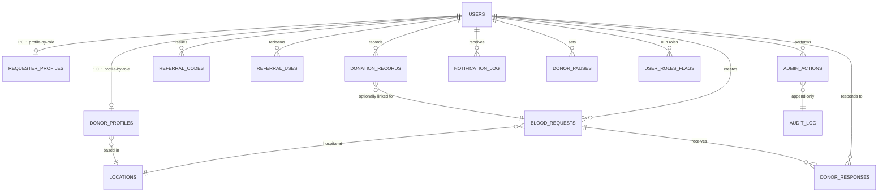

# Phase 1 — Repository Audit & Backend Architecture

**Status: PROPOSAL — not implemented. No substantial code changes yet.**
Date: 2026-10-10. Follows the Master Instructions (phased delivery, backend-first, RLS everywhere, no invented medical rules, no unofficial WhatsApp automation).

---

## 1. Repository Assessment

**State: empty scaffold.** The workspace is not a git repository and contains one Next.js app with zero product functionality.

| Item | Finding |
|---|---|
| App location | `my-app/` — Next.js **16.3.6** (App Router), React **19.2.8**, Tailwind CSS **4** (via `@tailwindcss/postcss`), TypeScript **5.x** (`strict: true`) |
| Package manager | **npm** (lockfileVersion 3). Node v26.8.1, npm 11.19.0 |
| Installed versions | No Supabase JS, no Zod, no test runner installed yet (framework defaults only) |
| Existing pages | `my-app/app/page.tsx` — default create-next-app landing page |
| Unrelated code | 5 map/portfolio components under repo-root `src/components/portfolio/`. These sit **outside** `my-app/` and conflict with its absolute `@/*` tsconfig alias (which resolves to `my-app/`). Not referenced by the Next app. Left untouched; relocate only if later phases need them |
| Environment config | None. No `.env*` files exist. Supabase env vars to be provided by you as `NEXT_PUBLIC_SUPABASE_URL`, `NEXT_PUBLIC_SUPABASE_ANON_KEY`, `SUPABASE_SERVICE_ROLE_KEY` |
| Database setup | None. No migrations, no schema, no Supabase project wiring |
| Git | Not initialized — init required before first code change |

**Conclusion:** Nothing to preserve but the scaffold; all product work is greenfield. The existing scaffold stays (Next 16 conventions verified against `node_modules/next/dist/docs` before writing code, since this version has known breaking changes vs older Next).

---

## 2. Backend Architecture and Module Separation

Layered, backend-first. Business rules live in services; route handlers are thin adapters (parse → validate → call service → typed response); components contain no business logic or DB access; Postgres RLS is the final enforcement layer.

```
UI components (minimal, dev-only for now)
        │  typed inputs/outputs
Route handlers (app/api/**)  ── thin: parse, validate, delegate
        │
Service layer (src/lib/services/**)  ── all business rules, ownership checks,
        │                              idempotency, structured logging
        │
Zod schemas (src/lib/validation/**)  ── one schema per endpoint, shared types
        │
Data access (src/lib/db.ts)          ── two Supabase clients:
        │       · anon/user client (RLS enforced — default)
        │       · service-role client (server-only; bypasses RLS for admin job,
        │         audit writes, and notification fan-out; never leaves server)
        │
PostgreSQL (Supabase) with RLS, stored procedures, triggers
```

### Modules

| Module | Responsibility | Home |
|---|---|---|
| `auth` | Supabase Auth integration (email/OTP), session reading, `getAuthUser()` helper, middleware guard | `my-app/src/lib/auth/` |
| `profiles` | User profile, donor-side profile (blood group, birth year, availability), requester-side contacts | `my-app/src/lib/services/profiles.ts` |
| `location` | Bounded location model: Bangladesh divisions → districts → upazilas lookup tables; coarse radius (km) rather than raw coordinates in ordinary outputs | `my-app/src/lib/services/location.ts` |
| `requests` | Blood request CRUD + lifecycle, idempotent creation, urgency, units, hospital ref | `my-app/src/lib/services/requests.ts` |
| `matching` | Candidate donor search: exact blood-group match → availability → district/upazila radius → fatigue caps → geo-fallback widening only when local results are insufficient | `my-app/src/lib/services/matching.ts` |
| `acceptance` | Donor accept/decline, contact-exchange consent enforcement, single donor lock per mutual confirmation step | `my-app/src/lib/services/acceptance.ts` |
| `notifications` | `NotificationProvider` interface; provider implementations behind it; idempotent delivery with delivery-log dedupe; retries with backoff | `my-app/src/lib/services/notifications/` |
| `history` | Donation records; recovery/eligibility rules table seeded only with **professionally approved** values; no auto "eligible" flag from dates alone | `my-app/src/lib/services/history.ts` |
| `referrals` | Referral code issue/redeem; community recognition ledger (points/badges), non-monetary | `my-app/src/lib/services/referrals.ts` |
| `admin` | Admin role flag on users, dashboards, reports, abuse flags | `my-app/src/lib/services/admin.ts` |
| `audit` | Append-only `audit_log` writes for sensitive actions (contact reveal, admin actions, consent changes) | `my-app/src/lib/services/audit.ts` |

### Cross-cutting rules
- **Authorization in 3 layers:** Supabase Auth JWT (who) → Postgres RLS (row ownership, always enforced even if a service bug skips a check) → service-level checks for friendlier error messages and cross-table rules.
- **Idempotency:** `blood_requests` and every notification send accept a client-supplied idempotency key; unique index prevents duplicate inserts and duplicate sends.
- **Server-only secrets:** `SUPABASE_SERVICE_ROLE_KEY` referenced only from server code (`src/lib/db.ts`), never imported into a client component; route handlers run on Node runtime.
- **Rate limits:** thin middleware on request-creation and notification endpoints (per-user token bucket) to blunt abuse.
- **Zod everywhere:** every route has a request schema; service return values are typed unions (`ok` | `err` with machine-readable codes) so UI never parses strings.

---

## 3. Preliminary Data Model

### Entity-relationship diagram



*Users, locations, and cross-linking tables are italicized notes in text below (Mermaid keeps the diagram readable); PK/FK/enums are spelled out in the next section.*

### Tables and relationships

| Table | Purpose / key columns | Relationships |
|---|---|---|
| `users` | Firebase-free Supabase `auth.users` is the identity source; public `profiles` table keyed by `auth.users.id` — carries display name, referral code joined, role flags (`is_donor`, `is_requester`, `is_admin`), contact-share consent | 1:1 with auth user; 1:0..1 donor/requester profiles |
| `donor_profiles` | Blood group, birth year, district/upazila, availability status, fatigue counters, last-donation date (record, **not** an eligibility claim) | FK → `profiles` (1:1); FK → `locations` |
| `requester_profiles` | Org/hospital name (optional), preferred contact method | FK → `profiles` (1:1) |
| `locations` | Lookup table: Bangladesh divisions → districts → upazilas, with centroid lat/lng and default search radius | Referenced by donor profiles & requests |
| `blood_requests` | Status enum (`draft → open → fulfilled/cancelled/expired`), blood group, units needed, urgency enum, required-by datetime, hospital name + location FK, idempotency key unique per requester | FK → `profiles`; FK → `locations` |
| `donor_responses` | One per (request, donor) pair: status enum (`invited → accepted/declined/expired`), consent-to-share-contact flag, accepted-at timestamp — **contact reveal happens only on accept** | FK → `blood_requests`, FK → `donor_profiles` |
| `donation_records` | Donor-created, optional link to fulfilled requests; feeds fatigue counters | FK → `donor_profiles` |
| `notification_log` | Outbound send ledger: provider, template, dedupe key (unique), status (`queued/sent/failed`), retry count | FK → `profiles` |
| `referral_codes` | Issued code, owner | FK → `profiles` |
| `referral_uses` | Redemption rows, points ledger for community recognition, **no monetary coupling** | FK → `referral_codes`, FK → `profiles` |
| `admin_actions` + `audit_log` | Append-only; `audit_log` is INSERT-only via RLS (no UPDATE/DELETE even for admins) | FK → `profiles` |
| `donor_pauses` | Explicit, timestamped donor breaks (auto-hide from matching while active) | FK → `donor_profiles` |
| `blood_group` | Postgres enum (`A+ A- B+ B- O+ O- AB+ AB-`); **exact match only**; compatibility matrix intentionally omitted pending qualified review | — |

**RLS targets (every exposed table):**
- `profiles`, `donor_profiles`, `requester_profiles`: INSERT/UPDATE only by owner; SELECT visible to authenticated users with **no phone or PII beyond name/district**.
- `blood_requests`: read to all authenticated; write only while status = open and owner; cancel by owner only.
- `donor_responses`: read by request owner and the donor themself; write only by the donor for their own row; contact fields (`shared_phone`) NULL until accept.
- `donation_records`, `donor_pauses`, `referral_uses`: owner-only read/write.
- `notification_log`, `audit_log`, `admin_actions`: service-role insert; users read only their own notification records; audit log readable by admins, never by regular users.
- `donor contact fields` (phone) never stored in `donor_profiles` SELECT path — phone lives in owner-only columns and surfaces ONLY at accept time to the specific request owner.

---

## 4. Lifecycles

### Request lifecycle (requester side)
```
draft ──create──▶ open ──donor accepts, confirmed──▶ matched ──donation done──▶ fulfilled
                    │
                    ├──expires (required-by passed)
                    └──cancelled by requester
```
- Create: Zod validates; idempotency key prevents duplicate request rows on retry.
- Match candidates computed at `open` time and re-run on each new degraded-response event; candidates are **ranked**, not auto-notified; the requester sees anonymized candidates (no phone); the platform notifies each candidate donor via the configured provider.
- An accepted donor's phone is revealed to the requester via `donor_responses.shared_phone` only at accept-time; this write happens in a single Postgres function so no intermediate state is observable.

### Donor-response lifecycle (donor side)
```
invited ──accept──▶ accepted (contact reveal to that requester only)
   │                     │
   └──decline──────────┼──▶ recorded (no further notifications for this request)
   └──expiry/pause─────┘
```
- Declining parks the donor out of this request's candidate list — donor-fatigue guard: a donor may not be re-invited to the same request, and request frequency caps throttled in the matcher, not in notifications (single decision point).
- Donor availability (`availability_status` + `donor_pauses`) gates candidates at match time; pause while invited is honored by the accept check.

---

## 5. API Endpoint Contracts (preliminary)

Base: `app/api/**`, all JSON, all Zod-validated, errors `{ code, message, field? }`. All cookie/session-based auth via Supabase.

| Method & path | Auth | Validation highlights | Purpose |
|---|---|---|---|
| `POST /api/auth/profile` | user | role flags, display name | create/update own profile |
| `GET /api/donors/search` | user | blood group, district/upazila, radius, pagination | **anonymized donor search** — never returns phone or home address |
| `POST /api/requests` | user | blood group, units (1..10), urgency, required-by (future), hospital, location, idempotency key | create request (idempotent) |
| `GET /api/requests` / `GET /api/requests/:id` | user | pagination | list own + detail (with anonymized candidates) |
| `PATCH /api/requests/:id` | owner only | allowed-status transitions only | cancel / edit while open |
| `POST /api/requests/:id/responses/:donorId` / `PATCH` | donor for own row | accept/decline, contact-consent | donor response; contact reveal on accept |
| `GET /api/notifications` | user | — | own notification history |
| `GET /api/donation-history` / `POST` | donor | date, optional request link, units | donor history (no eligibility auto-flag) |
| `POST /api/availability` | donor | available / paused (with optional until-date) | availability & pause |
| `POST /api/referrals/redeem` | user | code | non-monetary recognition credit |
| `PATCH /api/admin/...` | admin role | scoped resource | moderate requests/users; abuse flags; audit-logged |

**Authorization boundaries:** owner-vs-donor row access enforced in RLS; every admin route additionally re-checks `is_admin` in the service; all PII (phone) never appears in any list endpoint, only in the one accept-time detail.

---

## 6. External Services Requiring Configuration

| Service | Decision needed | Risk/policy |
|---|---|---|
| Supabase project | You create it; env vars only | Keys never in code/chat; service-role client server-only |
| Auth delivery (email/OTP) | Confirm email OTP vs phone OTP first | Defines schema & UX; affects rate-limit and anti-abuse design |
| Notification provider | **WhatsApp Business API**: only with written platform approval; until then, provider stays interface-only with a `mock`/`log` implementation |
| Hosting | Next.js needs a Node host (Vercel or similar) — or Cloudflare-Workers-adapted build if you want that path | Affects RLS/middleware and edge-function choices; decide before deploy phase |
| Rate limiting / abuse | In-memory token bucket is fine for dev; production host-provided or Upstash-Redis | Confirm budget |
| Maps/geo lookup | Needed only if UI shows a map; otherwise district/upazila dropdowns + computed radius are sufficient and more private | Geo-privacy per rule 10 |
| Analytics/error tracking | Optional; recommend later phase | Not blocking phase 2 |

**Env vars required (values supplied by you, never in code or chat):**

| Variable | Scope | Notes |
|---|---|---|
| `NEXT_PUBLIC_SUPABASE_URL` | client + server | Supabase project URL |
| `NEXT_PUBLIC_SUPABASE_ANON_KEY` | client + server | anon key; RLS still applies |
| `SUPABASE_SERVICE_ROLE_KEY` | **server only** | bypasses RLS; used only in `src/lib/db.ts` for admin/notification/audit operations |

---

## 7. Security Risks and Mitigations

| Risk | Severity | Mitigation |
|---|---|---|
| Donor phone/address exposure | Critical | Phone stored in owner-only columns; public search never joins it; RLS denies cross-user SELECT of contact fields; accept-time reveal is a single atomic DB function, audit-logged |
| Precise location leakage | High | Store district/upazila + coarse centroid only; no home address, no raw GPS in results (Master rule 10) |
| Service-role key in client bundle | Critical | Key used only in server modules; never imported by a client component; no `NEXT_PUBLIC_` prefix; build-time check in review checklist |
| Request spam / donor fatigue | Medium | Idempotency keys on request create; per-user rate limits; declining removes donor from that request's candidate list; matcher caps re-invite frequency |
| Fabricated confirmation UX | Medium | Status transitions enforced by DB enum + RLS + service; requests can never be marked `fulfilled` without a corresponding donation record or explicit requester confirmation |
| Notifications claimed but not sent | Medium | `notification_log` with provider response status; dev-only provider clearly labels every send as `MOCK — not delivered` (Master rule 16) |
| Unauthorized admin actions | High | `is_admin` role flag, checked in service AND in RLS; every admin action writes to append-only `audit_log` (INSERT-only for everyone) |
| Unofficial WhatsApp automation | Policy | Any WhatsApp usage goes through the `NotificationProvider` interface only, and only with written platform approval (Master rules 14/15) |
| Referral monetization creep | Policy | Recognition is points/badges only; no payment schema fields exist (Master rule 13) |
| Medical misinformation | High | No compatibility matrix, no auto-eligibility flags; recovery rules table seeds only after qualified-professional review (Master rules 11/12) |

---

## 8. Recommended Phase-by-Phase Implementation Plan

| Phase | Scope | Gate / exit criteria |
|---|---|---|
| **2** | Repo hygiene: git init, `.env.example`, install `@supabase/supabase-js` + `@supabase/ssr` + `zod`, wrap client, `getAuthUser()` helper; first migration: `profiles`, enums, initial RLS policies | Typecheck + lint pass; migration applies to a local/Supabase DB; RLS verified for owner/non-owner |
| **3** | Supabase Auth (email/OTP pending your confirmation), sign-up + sign-in routes + minimal dev UI to test them; session middleware | Both allowed and forbidden access tested (Master rule 5) |
| **4** | Locations (divisions/districts/upazilas seed) + `donor_profiles` + `requester_profiles` CRUD with ownership RLS; dev UI stub for profile editing | Profile CRUD tests pass for all roles |
| **5** | Blood requests: create (idempotent), list/detail, patch/cancel; status transitions; Zod schemas | Duplicate create attempts collapse into one row; status transition tests pass |
| **6** | Matching: candidate query (exact blood group only), district/upazila radius, geo-fallback, fatigue caps; anonymized donor search endpoint | Matching unit tests; **ensure no phone in search results** |
| **7** | Acceptance + contact reveal: `donor_responses`, atomic accept function, contact-share consent, audit write | Both accept and decline paths; verify contact shared to correct requester only |
| **8** | Notifications: provider interface, MOCK/log provider, idempotent delivery ledger; WhatsApp provider stub gated behind NOT_ENABLED flag | Idempotency test; duplicate-notification suppression verified |
| **9** | Donation history + availability/pause + fatigue counters wired into matcher | Pause honored by accept check; history affects matcher caps |
| **10** | Referrals (codes, non-monetary recognition) + admin baseline (role flag, basic reports, abuse flags, audit-log reads) | Admin diag: regular user sees 403; admin sees counts |
| **11** | Hardening: rate limits, structured logging, error taxonomy, load-test on matching, security review | Pen-test checklist; secrets leak scan |
| **12+** | Real notification provider (with WhatsApp approval), hosting deploy, then UI implementation phase (asks for your visual reference) | Deployed + smoke-tested |

---

## 9. Blocking Questions (awaiting your answers before implementation)

1. **Auth delivery: email OTP or phone OTP?** Bangladesh audience suggests phone OTP is the natural choice, but phone SMS requires a Twilio/Vonage-style provider and cost decision. Email is free (Supabase built-in). Which do you want for the first implementation phase, or both?
2. **Notification provider target:** Do you have a candidate in mind (e.g., a WhatsApp BSP), or should phase 8 start with the MOCK/log provider and defer the real one until approval exists? (Preferred: defer.)
3. **Hosting target:** Vercel, or an Cloudflare-Workers adapted build? This matters for whether we use Next.js server runtime freely or must keep Workers-compat.
4. **Location source:** I will seed Bangladesh divisions/districts/upazilas as a lookup table (no map UI needed, more private). Confirm this approach is acceptable, or you want lat/lng capture (coarse-rounded) as well?
5. **The `is_admin` bootstrap:** Who becomes the first admin — a flagged user via SQL insert, or an admin signup allowlist? (Preferred: flagged via SQL after sign-up, one-time.)
6. **Repo init:** OK to run `git init` + initial commit in the workspace root as the first Phase 2 step?
7. **Existing `src/components/portfolio` blocks:** leave untouched, or should I relocate into `my-app/src/components/portfolio/` to keep the tsconfig path resolution clean? (No functional effect until UI phases — leave untouched is fine for now.)

**Awaiting your approval before making substantial changes.**